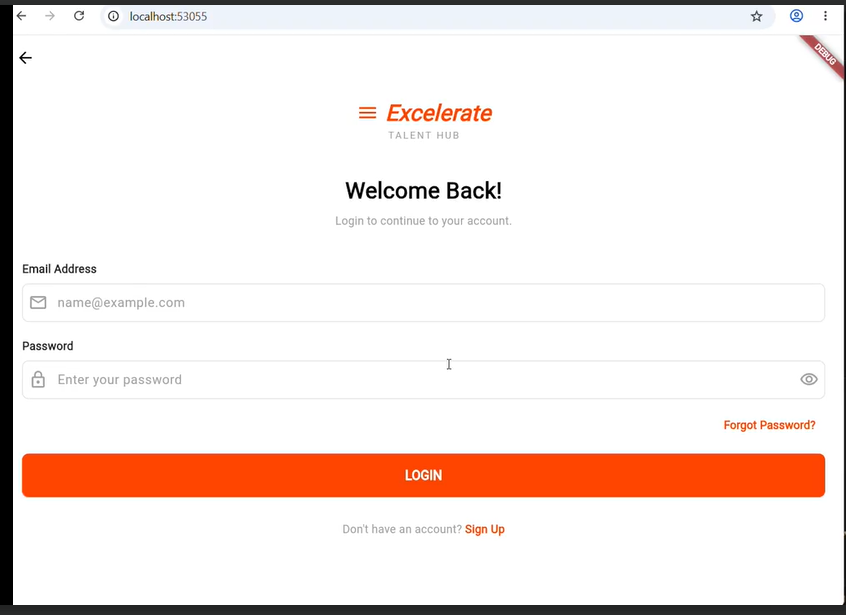
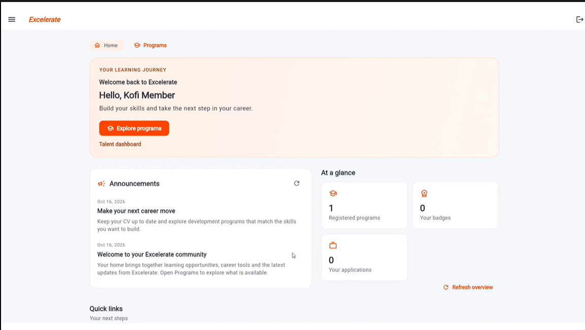
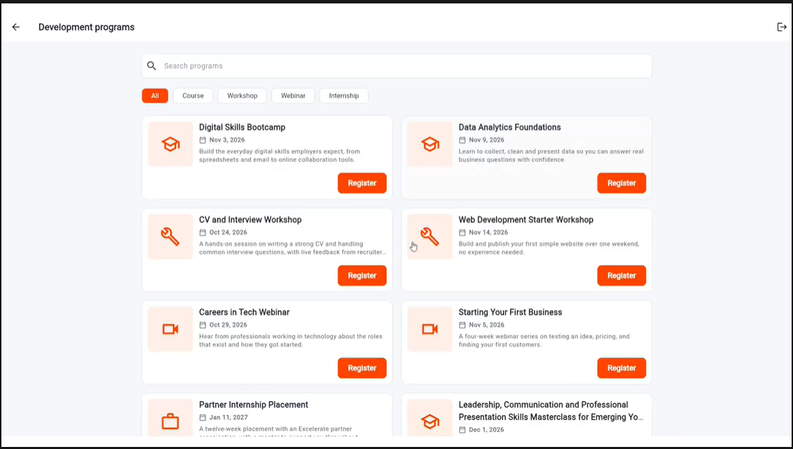
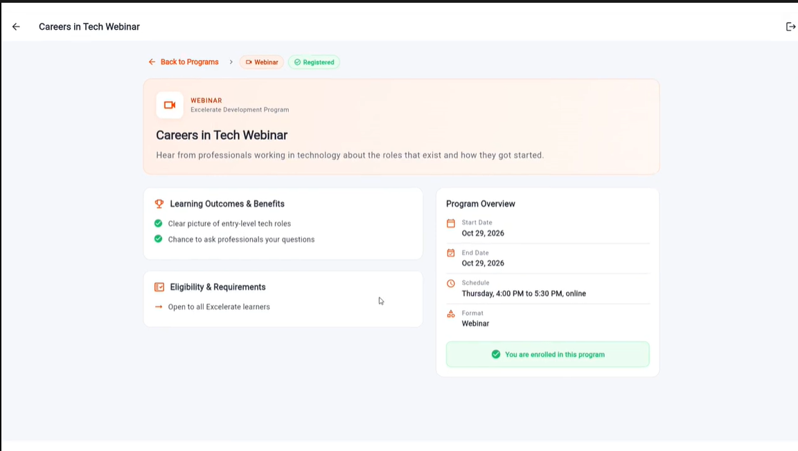

# Excelerate Talent Hub

Flutter-based engagement platform for learners and admins.

## Overview

Excelerate Talent Hub is a Flutter application designed to support onboarding, programme discovery, and role-based engagement for Excelerate users. The app includes learner and admin dashboards, protected routes, user authentication flows, and programme listing/detail experiences.

## Features

- Secure login and sign-up flow
- Role-aware learner and admin dashboards
- Programme listing and search experience
- Programme details with eligibility, outcomes, and schedule information
- Mock API-backed flow for local development and testing
- Responsive design aligned with the Excelerate design system

## Screenshots

The screenshots below show key UI screens from the app. The image files are stored in `docs/screenshots/` and the README references the uploaded filenames.

### 1. Login Screen



### 2. Learner Dashboard



### 3. Programme Listing



### 4. Programme Details



## Tech Stack

- Flutter
- Dart
- Provider for state management
- SharedPreferences for local session storage
- Mock API for local development and testing

## Prerequisites

- Flutter SDK installed
- Android Studio / Xcode / Chrome for device or browser testing
- Optional: Android Emulator, iOS Simulator, or Chrome for running the app

## Getting Started

1. Clone the repository:

   ```bash
   git clone https://github.com/Ruby160612/excelerate-engagement-app.git
   cd excelerate-engagement-app
   ```

2. Install dependencies:

   ```bash
   flutter pub get
   ```

3. Run with the mock backend:

   ```bash
   flutter run --dart-define=USE_MOCK=true
   ```

4. Run against a real backend (if configured):

   ```bash
   flutter run --dart-define=USE_MOCK=false --dart-define=API_BASE_URL=https://your-api-url
   ```

5. Run the test suite:

   ```bash
   flutter test
   ```

## Project Structure

- `lib/` — Flutter application source code
- `test/` — widget and unit tests
- `docs/` — project documentation and design guidance
- `docs/screenshots/` — UI screenshots referenced in the repository documentation

## Program Data Flow

Program list, detail, registration and learner dashboard counts use typed models:

```text
Program screens -> ProgramStore -> ProgramRepository -> ProgramService
Detail loader / dashboard -> ProgramRepository -> ProgramService
  -> MockProgramService -> existing MockApi + assets/data/programs.json
  -> ApiProgramService -> existing HTTP API
  -> FirebaseProgramService (placeholder; not enabled by default)
```

`ExcelerateApp(programService: ...)` accepts another implementation without screen changes.
Mock mode keeps the existing per-learner state, loading, search/category filters,
empty states and manual retry controls. Registrations update subsequent reads;
duplicates produce a typed `alreadyRegistered` error. Mock state resets on restart.

See [Program API contract](docs/PROGRAM_API_CONTRACT.md) for typed response shapes,
legacy HTTP compatibility, database relationships, error/retry rules, the inspection
inventory and the Firebase teammate handoff. Serialization uses the existing manual
`fromJson` / `toJson` pattern; no code generator or live Firebase is required by tests.

### Mock mode sign-in

Run with `--dart-define=USE_MOCK=true` and sign in with:

| Role | Email | Password |
| --- | --- | --- |
| Learner (completes the profile step first) | `learner@example.com` | `learner123` |
| Learner (profile completed) | `member@example.com` | `member123` |
| Admin | `admin@example.com` | `admin123` |

The signup invitation code in mock mode is `EXCEL2026`. The mock backend lives in memory, so registrations and sessions reset when the app restarts or the browser page is refreshed.

## State Management

The app uses Provider. Two classes in `lib/state/` hold the shared state so screens do not keep duplicate copies of it.

| File | Role |
| --- | --- |
| `lib/state/program_store.dart` | `ProgramStore`: the program list (idle / loading / loaded / error), the selected program and registration. A quiet refresh keeps the current list if it fails. A second register call for the same program is ignored while one is running |
| `lib/state/submission_controller.dart` | `SubmissionController`: form values, per-field validators and error messages, and the submit status |

Submit status flow: `idle -> validating -> submitting -> success`, or `idle -> validating -> error`. While a request is running, further submits are ignored. `reset()` returns the form to idle and clears the values (or keeps them with `reset(keepValues: true)`), so an error never stays stuck after a retry.

Using the controller in a form:

```dart
final form = SubmissionController(
  initialValues: {'email': ''},
  validators: {'email': (v) => v.isEmpty ? 'Enter your email' : null},
);

form.setValue('email', text);                 // on every change
final ok = await form.submit((values) async { // validates, then runs the action
  await api.send(values);
});
// Read form.status, form.isSubmitting, form.errorOf('email') and form.message in the UI.
```

Screens that read the state: `ProgramsListView` and `ProgramDetailsView` (Register). Forms being connected to `SubmissionController` under the state management task: the sign-up form (`lib/widgets/auth_form.dart`) and the Feedback form.

Tests: `test/program_store_test.dart` and `test/submission_controller_test.dart` cover the state transitions, repeated submits and reset behaviour.

## Design Documentation

Refer to the product and UX design rationale here:

- `docs/SPRINT2_DESIGN.md`

## Repository

- GitHub: https://github.com/Ruby160612/excelerate-engagement-app


###For Firebase Integration ###

## Backend / Firebase Integration Handoff

The backend/data integration layer has been prepared so the Flutter UI is no longer tightly coupled to mock JSON or a single backend implementation.

The current architecture is:

`UI → ProgramStore → ProgramRepository → ProgramService → Mock / API / Firebase implementation`

This allows the team to continue using mock data locally while a real Firebase-backed implementation is completed later without rewriting the program screens.

### Current State

- Firebase has been configured for the project.
- `firebase_core`, `firebase_auth`, and `cloud_firestore` are installed.
- Firebase platform configuration files have been generated.
- Program models and backend-ready response models are defined.
- Program IDs and registration IDs use `String` values and are ready for Firebase document IDs.
- Program search, filtering, details, registration, loading, error, and retry flows are routed through the shared data layer.
- `ProgramService` defines the backend-facing contract.
- `MockProgramService` provides the current local/mock implementation.
- `ApiProgramService` supports the existing API-style path.
- `FirebaseProgramService` exists as the boundary for the future Firestore implementation.
- `ProgramRepository` sits between application state and the selected service implementation.
- `ProgramStore` remains the UI-facing state layer.
- Backend request/response shapes, identifiers, relationships, and error/retry expectations are documented in `docs/PROGRAM_API_CONTRACT.md`.

### Mock Mode

The existing mock backend is still available and should be used for local development until the Firebase backend is fully implemented.

Run the app with:

```bash
flutter run --dart-define=USE_MOCK=true
```

With `USE_MOCK=true`, the app uses the existing mock authentication and mock program data.

Without that flag, `USE_MOCK` defaults to `false` and the application follows the non-mock/backend path.

### Firebase / Firestore Direction

The expected Firebase data structure is based around:

```text
programs/{programId}
```

and:

```text
program_registrations/{registrationId}
```

A registration should reference:

```text
programId
learnerId
status
registeredAt
```

The future Firebase implementation should preserve the same `ProgramService` behavior as the mock implementation so existing screens and `ProgramStore` do not need to be rewritten.

### Validation Completed

The integration has been validated with:

```bash
flutter analyze
flutter test
flutter build apk --debug
```

The application has also been successfully built, installed, launched, and debugged on a physical Android device.

Mock-mode login and program flows have been verified with:

```bash
flutter run --dart-define=USE_MOCK=true
```

### Next Developer Steps

The next backend developer should:

1. Implement the real Firestore logic inside the Firebase service layer.
2. Connect real authentication and learner identity to Firebase Auth.
3. Persist program registrations in Firestore.
4. Preserve the existing service contract and `ProgramStore` flow.
5. Keep mock mode available for development and testing.
6. Review `docs/PROGRAM_API_CONTRACT.md` before changing request/response behavior.

There is currently a separate UI/data issue where the name entered during signup is not reflected consistently after login. This should be handled independently from the program backend integration unless the real authentication/profile implementation naturally resolves it.